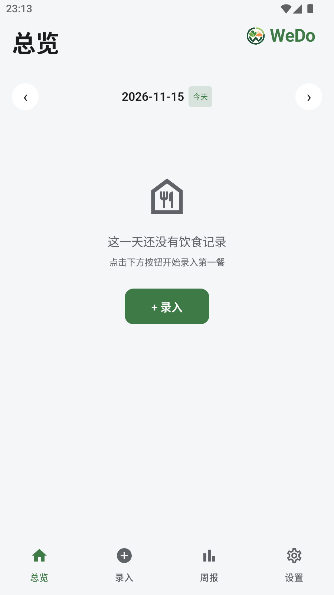
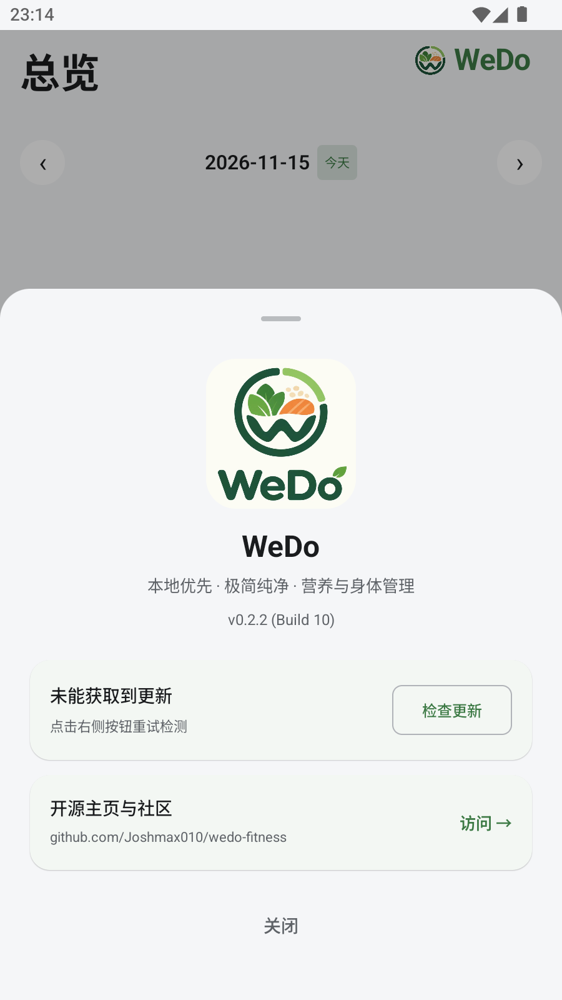
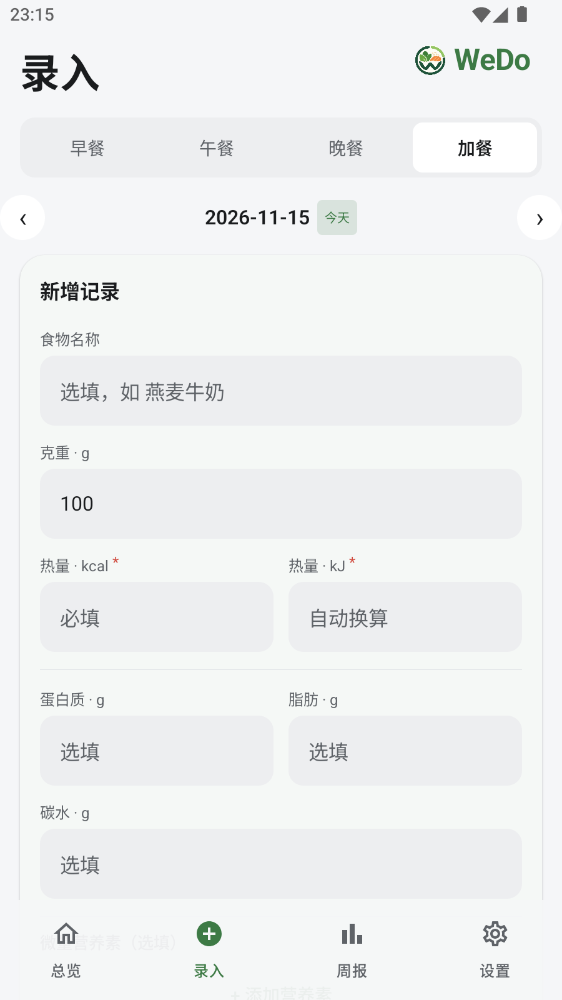
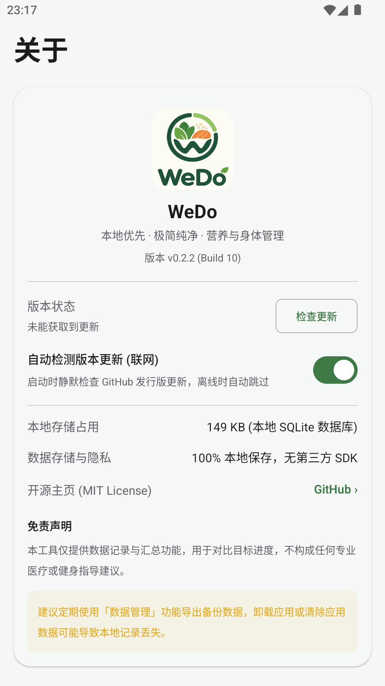

<p align="center">
  
</p>

<p align="center">
  <strong>WeDo</strong><br>
  <em>Android 本地优先 · 高颜值饮食记录与身体数据管理工具</em>
</p>

<p align="center">
  <a href="https://github.com/Joshmax010/wedo-fitness/releases/latest"></a>
  <a href="https://developer.android.com"></a>
  <a href="https://github.com/Joshmax010/wedo-fitness/actions/workflows/cloud-tests.yml"></a>
  <a href="./LICENSE"></a>
</p>

---

## 📖 产品介绍

**WeDo** 是一款专为 Android 平台打造的**本地优先、纯粹无干扰**的营养记录与身体健康管理工具。

在这个充满广告、社交绑定与订阅制的时代，WeDo 坚持回归记账与记录的本质——**轻快、优雅、不打扰、数据完全属于你自己**。无需注册账号，没有开屏广告，核心功能在完全断网的环境下也能流畅运行。你可以轻松按餐次记录每一餐的热量与三大营养素，实时对照每日目标，追踪长期体重与代谢变化趋势。

<p align="center">
  <a href="https://github.com/Joshmax010/wedo-fitness/releases/download/v0.2.3/wedo-fitness-v0.2.3.apk"><strong>📦 下载最新安装包 v0.2.3</strong></a>
  &nbsp;·&nbsp;
  <a href="https://github.com/Joshmax010/wedo-fitness/releases/tag/v0.2.3">版本更新日志</a>
  &nbsp;·&nbsp;
  <a href="#english">English Documentation</a>
</p>

---

## 🖼️ 界面赏析

<table align="center">
  <tr>
    <td align="center" width="25%"><b>总览仪表盘</b></td>
    <td align="center" width="25%"><b>WeDo 品牌面板</b></td>
    <td align="center" width="25%"><b>零阻断记餐</b></td>
    <td align="center" width="25%"><b>设置与品牌门户</b></td>
  </tr>
  <tr>
    <td></td>
    <td></td>
    <td></td>
    <td></td>
  </tr>
</table>

---

## ✨ 核心特性

- 🍏 **100% 本地优先，坚守隐私底线**  
  无账号体系、零云端遥测、绝不上传任何个人健康隐私数据。所有饮食与身体记录完全存储在手机本地 SQLite (Room) 数据库中，卸载前可随时导出完整备份。
- ⚡ **零阻断流畅记餐，即点即存**  
  录入食物无需面对繁琐的确认弹窗；支持 kcal / kJ 双向实时换算，输入克重自动折算实际摄入，自带 200 余种常见食材库与智能联想补全。
- 🎨 **现代 Material 3 质感重塑**  
  自然光影微浮雕卡片架构、活力高饱和营养色谱（蛋白质靛蓝、脂肪暖橙、碳水翠绿）、流体圆角胶囊滑动 Tab 与触感弹性微交互，让日常记录成为一种享受。
- 📊 **多维趋势与科学代谢洞察**  
  7 日营养趋势折线图与分组柱状图、身体成分追踪（体重、体脂率、肌肉量）；内置基于 Mifflin-St Jeor 权威公式的代谢计算器，智能估算 BMR / TDEE 并一键套用推荐宏量目标。
- 📦 **纯粹透明的 JSON 自由冷备份**  
  明文可读的标准 JSON 格式，导入前提供完整数据项预览与差异确认，换机迁移零门槛，数据绝对自由。
- 🔄 **轻如鸿毛的静默版本更新**  
  零额外依赖的极轻量原生探测，发现新版本时仅在顶栏胶囊与设置项悄然亮起微小绿点，绝不弹窗打扰；更提供彻底断网的物理硬开关，将网络控制权完全交给用户。

---

## 📱 模块功能概览

| 模块 | 核心功能 |
| :--- | :--- |
| **总览仪表盘** | 当日热量达成圆环、差值清晰表意、三大宏量营养素进度条、四餐热量分布卡片，支持左右手势切换日期与日历跳转 |
| **饮食录入** | 早餐、午餐、晚餐、加餐四餐独立切换；智能根据当前系统时间推测餐次；食物名称自动补全与克重换算；历史卡片支持左滑快捷删除 |
| **食物库与标签** | 内置 200+ 常见食材营养数据，支持自定义食物模板、多标签快捷分类与模糊搜索筛选 |
| **周报统计** | 自然周（周一至周日）热量走势折线图与营养素柱状图，计算达标率与平均缺口，支持一键复制纯文本周报 |
| **身体档案与代谢** | 记录体重、体脂率与肌肉量并绘制长期趋势；根据性别、年龄、身高、体重与活动系数科学推算 BMR 与 TDEE |
| **外观与偏好** | 深度适配浅色模式、深色模式与跟随系统；微量营养素默认智能折叠收起，按需一键展开 |
| **数据管理** | JSON 格式冷备份导出至剪贴板，支持导入前全量内容预览，兼容历史版本数据格式 |

---

## 📦 下载安装

### 最新版本信息

- **当前版本**：`0.2.3`（versionCode `11`）
- **安装包大小**：约 `2.55 MB`（无臃肿第三方依赖）
- **系统要求**：Android 8.0（API 26）及以上
- **下载地址**：[wedo-fitness-v0.2.3.apk](https://github.com/Joshmax010/wedo-fitness/releases/download/v0.2.3/wedo-fitness-v0.2.3.apk)
- **SHA-256 校验码**：`06ffba0c74b4a633518b46f5fefd247eb77b6ddde0bfe30348ae189d938ce7df`

### 安装与升级说明

1. 从 [GitHub Releases](https://github.com/Joshmax010/wedo-fitness/releases/latest) 下载最新 APK。
2. 手机打开安装包并授予安装权限即可完成安装。
3. **正式版升级**：所有正式版本均使用官方正式密钥签名，后续版本可直接**覆盖升级**，本地数据完整保留。
4. **备份建议**：在跨版本重大升级或更换设备前，建议先在「设置 → 数据管理」中将备份 JSON 导出保存至个人备忘录或本地文件中。

---

## 🔒 数据与隐私承诺

WeDo 坚信，用户的健康与饮食数据属于且仅属于用户个人：

1. **绝对本地化**：所有日常数据皆持久化保存在设备本地的 SQLite 数据库中，偏好设置存储于 Android SharedPreferences。
2. **零数据遥测**：应用绝无任何第三方统计 SDK、追踪埋点、广告投放或个人信息上传。
3. **极简网络权限**：仅申请 `android.permission.INTERNET` 用于直连 GitHub 检查静态版本日志（2.5 秒超时静默兜底）。在「设置 → 关于」中可随时关闭联网检测开关，关闭后完全隔绝网络通信。
4. **彻底的数据自主权**：用户可随时导出全部数据的明文 JSON 备份，也可在设置中一键清空本地饮食历史。

---

## 🛠️ 技术架构

WeDo 严格遵循现代 Android 开发最佳实践与架构指南构建：

```
app/src/main/java/com/example/nutrition/
├── data/          # 数据层：Room Database、DAO、Entity、本地存储仓库实现
├── domain/        # 领域层：纯业务模型 (Model)、纯用例函数 (UseCase)、常量定义
├── viewmodel/     # 表示层：MVI 风格 ViewModel (单一 UiState + Channel 事件流)
├── ui/            # 界面层：Jetpack Compose 页面、Navigation 路由、组件、图表与主题
└── updater/       # 更新模块：原生轻量化静默版本探测器
```

| 层级 | 技术选型 | 说明 |
| :--- | :--- | :--- |
| **编程语言** | Kotlin 2.2.10 | 100% 现代 Kotlin 代码，开启严格模式 |
| **UI 框架** | Jetpack Compose + Material 3 | 声明式响应式 UI，深度定制 M3 配色与微交互 |
| **架构模式** | MVI-style MVVM | 单一不可变 `UiState`（StateFlow）+ 一次性事件（Channel）+ UseCase |
| **路由导航** | Navigation Compose 2.8.2 | 类型安全路由（@Serializable route 对象传参） |
| **持久化存储** | Room 2.8.4 (SQLite) | 经 KSP 生成，响应式 Flow 自动驱动 UI 刷新 |
| **序列化** | kotlinx.serialization 1.6.3 | 极速无反射 JSON 序列化，支持路由与备份 |
| **质量保障** | JUnit 4 + Coroutines Test | 单元测试全覆盖，CI 自动化回归流水线 |

---

## 💻 从源码构建

本项目采用标准 Gradle Wrapper 构建，无需安装任何复杂的非标工具链。

### 环境要求

- **JDK**：21（推荐 Temurin 或 JetBrains JDK 21）
- **Android SDK**：API 34（Android 14）
- **Gradle**：9.4.1（由根目录 `./gradlew` 自动按需下载）

### 本地编译与测试

```bash
# 1. 克隆代码仓库
git clone https://github.com/Joshmax010/wedo-fitness.git
cd wedo-fitness

# 2. 编译 Debug APK 并运行全套单元测试与 Lint 检查
./gradlew :app:assembleDebug :app:testDebugUnitTest :app:lintDebug
```

在 Windows PowerShell 下执行：

```powershell
.\gradlew.bat :app:assembleDebug :app:testDebugUnitTest :app:lintDebug
```

构建完成后，Debug APK 输出位于：`app/build/outputs/apk/debug/app-debug.apk`。

---

## 📄 开源协议

本项目依据 [MIT License](./LICENSE) 开源。欢迎 Star、Fork、提交 Issue 或发起 Pull Request 共同完善！

Copyright © 2026 [Joshmax010](https://github.com/Joshmax010)

---

<a name="english"></a>
## 🌐 English

<details>
<summary><strong>Click to expand English introduction</strong></summary>

### Overview

**WeDo** is a local-first, privacy-respecting, and beautifully crafted nutrition and body metrics tracker for Android 8.0+.

In an era crowded with account paywalls, trackers, and subscription popups, WeDo delivers a distraction-free, pure recording experience. No account registration is required, and all core features function seamlessly offline.

### Key Highlights

- **100% Local-First & Zero Telemetry**: All nutrition records, body composition logs, and templates stay strictly on your local device inside a Room (SQLite) database.
- **Frictionless Logging**: Instant meal recording with zero blocking popups. Features automatic bidirectional conversion between kcal and kJ, intelligent weight-based nutrient recalculation, and a preloaded catalog of 200+ foods.
- **Material 3 Craftsmanship**: Floating ambient card depth, vibrant nutrient color-coding (Indigo for Protein, Amber for Fat, Emerald for Carbs), fluid pill slider tabs, and tactile spring haptics.
- **Scientific Insights**: Natural-week caloric trend lines and grouped nutrient bar charts, body composition tracking (weight, body fat percentage, muscle mass), and BMR/TDEE calculations powered by the Mifflin-St Jeor equation.
- **Transparent JSON Backup**: Plain human-readable JSON export to clipboard and comprehensive preview before restore.
- **Minimalist Update Indicator**: Zero-dependency silent update probe via GitHub Pages and GitHub API. Displays an unobtrusive green dot badge on the brand capsule, accompanied by a complete offline privacy toggle in settings.

### Download

- **Latest Release**: [v0.2.3 APK Download](https://github.com/Joshmax010/wedo-fitness/releases/download/v0.2.3/wedo-fitness-v0.2.3.apk) (~2.55 MB)
- **SHA-256**: `06ffba0c74b4a633518b46f5fefd247eb77b6ddde0bfe30348ae189d938ce7df`

### Tech Stack

- Kotlin 2.2.10
- Jetpack Compose & Material 3
- MVI-style MVVM (StateFlow + Channel UIEvent)
- Type-safe Navigation Compose 2.8.2
- Room 2.8.4 via KSP
- kotlinx.serialization 1.6.3

### Build from Source

```bash
git clone https://github.com/Joshmax010/wedo-fitness.git
cd wedo-fitness
./gradlew :app:assembleDebug :app:testDebugUnitTest :app:lintDebug
```

### License

Open-sourced under the [MIT License](./LICENSE).

</details>
